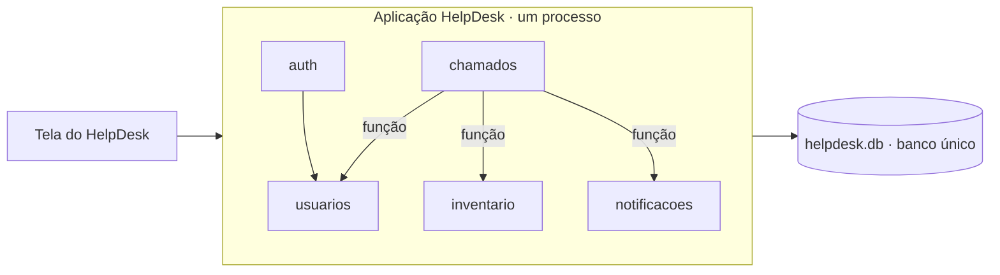
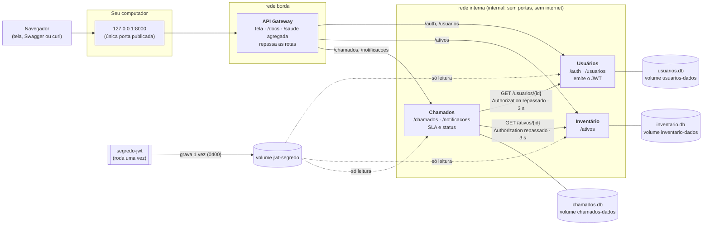

# HelpDesk TI · versão em microsserviços

> 🎬 **Vídeo de demonstração:** _link a incluir após a gravação_

Sistema de chamados de TI (no estilo de um GLPI simplificado), feito em **Python + FastAPI**.
Ele começou como um **monólito** e, nesta atividade de **Arquitetura de Software**, foi dividido em
**três microsserviços e um API Gateway**, como pede o [DESAFIO.md](DESAFIO.md).
O monólito original continua no repositório (pasta `app/`), para comparação.

**Sumário:** [Objetivo](#objetivo) · [Arquitetura](#arquitetura) · [Serviços](#responsabilidades-dos-serviços) ·
[Gateway e rotas](#api-gateway-e-rotas) · [Bancos](#bancos-independentes) · [HTTP](#comunicação-http-entre-serviços) ·
[JWT](#autenticação-jwt) · [Falhas](#falhas-e-tempos-limite) · [Segurança e rede](#segurança-e-rede) ·
[Como rodar](#instalação-e-execução) · [Contas](#contas-de-acesso) · [Endpoints](#endpoints) · [Testes](#testes) ·
[Decisões](#decisões-arquiteturais) · [Limitações](#limitações-conhecidas)

## Objetivo

Separar o HelpDesk em serviços independentes, cada um com o próprio banco e o próprio contêiner,
**sem mudar nada para quem usa**: as mesmas telas, as mesmas rotas, as mesmas regras (SLA, transições
de status, permissões por perfil) e o mesmo endereço, `http://localhost:8000`.

## Telas do sistema


| Login | Painel do técnico | Chamado resolvido |
|---|---|---|
|  |  |  |

As imagens são do monólito. A tela é a mesma; só o subtítulo do cabeçalho mudou para "versão em microsserviços".

## O que o sistema faz

- **Login** com e-mail e senha; cada pessoa vê e faz só o que o seu perfil permite.
- Cadastra **usuários** e **equipamentos** (inventário de TI).
- **Abre chamados** com prioridade e calcula o prazo de atendimento (SLA): crítica 4 h, alta 8 h, média 24 h, baixa 72 h.
- **Atribui** chamados a técnicos, controla o **status** e aceita **comentários**.
- Registra **notificações** quando um chamado é aberto, atribuído ou resolvido.
- Mostra um **painel** com totais por status e chamados atrasados.

### Perfis e permissões

| Ação | Solicitante | Técnico | Administrador |
|---|:-:|:-:|:-:|
| Abrir chamado | ✅ | ✅ | ✅ |
| Ver chamados | só os seus | todos | todos |
| Comentar | nos seus | todos | todos |
| Atribuir e resolver | ❌ | ✅ | ✅ |
| Fechar ou reabrir um chamado resolvido | os seus | ✅ | ✅ |
| Cadastrar equipamentos | ❌ | ✅ | ✅ |
| Cadastrar usuários | ❌ | ❌ | ✅ |

## Arquitetura

### Antes: monólito

Uma aplicação, um banco e uma implantação. Os módulos conversavam por **chamadas de função**.



### Agora: microsserviços

Cada serviço é um processo, um contêiner e um banco. Todos ficam atrás do gateway, que é a única porta de entrada.



Na prática:

1. O navegador só fala com o **gateway**, pela porta 8000.
2. O gateway olha o começo do caminho e repassa a requisição, com o token, ao serviço certo.
3. Cada serviço **confere o token sozinho**, com o segredo compartilhado, e responde com os dados do próprio banco.
4. Para abrir um chamado com equipamento ou atribuir um técnico, o Chamados **pergunta por HTTP**
   ao Inventário ou ao Usuários, repassando o token de quem fez o pedido.

## Responsabilidades dos serviços

| Serviço | Pasta | Faz | Banco | Depende de |
|---|---|---|---|---|
| **Usuários** | [servicos/usuarios](servicos/usuarios) | Login (senha scrypt, limite de tentativas), emissão do JWT, `/auth/eu`, cadastro e consulta de usuários | `usuarios.db` | ninguém |
| **Inventário** | [servicos/inventario](servicos/inventario) | Cadastro e consulta de equipamentos | `inventario.db` | ninguém |
| **Chamados** | [servicos/chamados](servicos/chamados) | Chamados, SLA, transições de status, comentários, painel e notificações | `chamados.db` | Usuários e Inventário (HTTP) |
| **Gateway** | [gateway](gateway) | Ponto único de entrada: tela, documentação unificada, saúde agregada e repasse das rotas | nenhum | os três serviços |
| **segredo-jwt** | [infra/segredo-jwt](infra/segredo-jwt) | Gera o segredo JWT na primeira subida e termina | — | — |

Cada serviço tem o seu próprio código, Dockerfile, `requirements.txt` e testes. Ele pode ser construído,
testado e publicado sem os outros.

## API Gateway e rotas

O gateway ([gateway/app/proxy.py](gateway/app/proxy.py)) escolhe o serviço pelo prefixo do caminho:

| Prefixo | Serviço |
|---|---|
| `/auth`, `/usuarios` | Usuários |
| `/ativos` | Inventário |
| `/chamados`, `/notificacoes` | Chamados |
| `/`, `/app.js`, `/estilo.css` | o próprio gateway (tela) |
| `/docs`, `/openapi.json`, `/saude` | o próprio gateway |
| qualquer outro | 404, sem chamar nenhum serviço |

- O método, o caminho, a query string, o corpo e o `Authorization` vão **como vieram**.
  A resposta volta com o mesmo código e os mesmos cabeçalhos.
- O gateway **não confere o token** nem guarda o segredo: quem decide é cada serviço.
  Assim, nenhuma regra de permissão fica duplicada no gateway.
- O `/openapi.json` junta a documentação dos três serviços. Em `/docs`, o Swagger mostra todas as rotas
  num lugar só (clique em **Authorize** e cole o token do login).
- O `/saude` consulta os três serviços e responde `"ok"` ou `"degradado"`, dizendo quem está fora do ar.

## Bancos independentes

- Cada serviço tem o seu **SQLite** num **volume Docker só dele**.
  - `usuarios.db` tem a tabela `usuarios`.
  - `inventario.db` tem a tabela `ativos`.
  - `chamados.db` tem as tabelas `chamados`, `comentarios` e `notificacoes`.
- Nenhum serviço monta o volume de outro, e nenhum lê o banco de outro. Se precisa de um dado de fora,
  pergunta pela API.
- Em `chamados.db`, `solicitante_id`, `tecnico_id` e `ativo_id` são números simples, **sem chave estrangeira**,
  porque essas tabelas estão em outros bancos. A existência é conferida por HTTP no momento da gravação.

## Comunicação HTTP entre serviços

| Quando | Chamados chama | Para conferir |
|---|---|---|
| Abrir chamado com `ativo_id` | Inventário `GET /ativos/{id}` | que o equipamento existe |
| Atribuir chamado | Usuários `GET /usuarios/{id}` | que a pessoa existe e é técnica |

As regras ficam em [servicos/chamados/app/clientes.py](servicos/chamados/app/clientes.py):

- **Token:** o `Authorization` de quem fez o pedido é repassado exatamente como veio. O Chamados não cria
  token próprio nem "credencial de serviço", então o outro serviço aplica as permissões da própria pessoa.
- **Tempo limite:** 3 s por chamada (`HTTP_TIMEOUT_SEGUNDOS`). Os endereços vêm do ambiente: `USUARIOS_URL` e `INVENTARIO_URL`.
- **Respostas:**
  - `404` vira "Ativo N não encontrado." ou "Usuário N não encontrado.", a mesma mensagem do monólito.
  - Pessoa que não é técnica dá `422`, a mesma regra de negócio de antes.
  - Sem resposta, tempo esgotado, `5xx`, `401` ou `403` vindos de lá, ou resposta fora do formato viram
    **`503`** com mensagem genérica. Os detalhes vão só para o log, e uma falha de rede nunca é tratada
    como erro de regra de negócio.
- Redirecionamentos não são seguidos, e proxies do ambiente são ignorados (`trust_env=False`).

## Autenticação JWT

1. **Emissão:** só o Usuários faz login e emite o token: HS256, emissor `helpdesk-ti`, validade de
   `TOKEN_MINUTOS`, com os campos `sub` (id) e `perfil`.
2. **Conferência em todo serviço:** cada serviço valida o token localmente, sem perguntar a ninguém.
   - Confere assinatura, algoritmo fixo, emissor e validade.
   - Exige todos os campos e só aceita perfis conhecidos.
   - O Usuários, que tem o banco de usuários, também confere se a conta existe e está ativa.
3. **Segredo compartilhado:**
   - o contêiner `segredo-jwt` gera 48 bytes aleatórios (`secrets`) na primeira subida e os grava no volume
     `jwt-segredo` (arquivo 0400, pasta 0500);
   - os três serviços leem esse arquivo (`JWT_SEGREDO_ARQUIVO`), montado só para leitura;
   - o segredo **não está no código, no `.env`, nas variáveis de ambiente nem nos logs**;
   - se o arquivo estiver faltando ou curto, o serviço **não sobe**, para nunca assinar com um segredo diferente dos outros.
4. **Permissões:** o perfil usado nas regras é sempre o do token assinado, nunca um campo enviado pelo cliente.

## Falhas e tempos limite

| Situação | O que acontece |
|---|---|
| Inventário fora do ar | `/ativos` e abrir chamado **com** equipamento: **503** "O serviço de inventário está indisponível…". Usuários, chamados, painel e tela continuam funcionando |
| Usuários fora do ar | Login, `/usuarios` e atribuir: **503**. Quem já tem token continua vendo chamados e equipamentos |
| Chamados fora do ar | `/chamados` e `/notificacoes`: **503**. O resto funciona |
| Serviço lento | Chamados desiste em **3 s**; o gateway desiste em **10 s**, que fica acima dos 3 s para o 503 do Chamados chegar à tela |
| `GET /saude` | `"degradado"` e o nome do serviço `"fora do ar"`. O gateway continua respondendo 200 |
| Serviço volta | O Docker reinicia contêineres que caem sozinhos (`restart: unless-stopped`); o próximo pedido já funciona |

## Segurança e rede

O resumo está aqui; os detalhes ficam em [SECURITY.md](SECURITY.md).

- **Só o gateway publica porta**, e só em `127.0.0.1:8000`, ou seja, apenas para o próprio computador.
- **Redes:**
  - `borda` tem só o gateway.
  - `interna` (`internal: true`) tem o gateway e os serviços: não tem saída para a internet e não pode ser
    alcançada de fora.
- **Contêineres:**
  - sistema de arquivos somente leitura;
  - `cap_drop: ALL` e `no-new-privileges`;
  - usuário sem privilégios (uid 10001);
  - `/tmp` em memória, limitado a 16 MB, só nos serviços com banco.
- **Endereço do cliente:**
  - o gateway descarta `X-Forwarded-For`, `X-Real-IP` e `Forwarded` enviados pelo cliente e escreve o seu;
  - os serviços só aceitam esse cabeçalho vindo do IP fixo do gateway (`FORWARDED_ALLOW_IPS`);
  - assim, o bloqueio de tentativas de login não é contornado forjando o cabeçalho.
- **Gateway:** os mesmos cabeçalhos de segurança do monólito (CSP, `X-Frame-Options`…), limite de 64 KB por
  requisição, e nada de tokens nos logs.

## Instalação e execução

**Pré-requisito:** Docker com Docker Compose v2 (por exemplo, Docker Desktop). Não é preciso ter Python
instalado nem criar `.env`.

```bash
git clone <este repositório>
cd helpdesk-microsservicos-gabriel-menezes
docker compose up --build
```

Na primeira vez, a construção leva alguns minutos. O sistema está pronto quando `docker compose ps` mostrar os
quatro serviços `healthy` e o `segredo-jwt` como `Exited (0)`. A ordem de subida é automática:
`segredo-jwt` → `usuarios` e `inventario` → `chamados` → `gateway`.

Depois abra:

- Tela do HelpDesk: http://localhost:8000
- Documentação da API (Swagger): http://localhost:8000/docs
- Saúde dos serviços: http://localhost:8000/saude

| Comando | Para quê |
|---|---|
| `docker compose ps` | Ver o estado de cada contêiner e as portas |
| `docker compose logs -f chamados` | Acompanhar os logs de um serviço |
| `docker compose stop inventario` / `docker compose start inventario` | Simular a queda de um serviço e a volta |
| `docker volume ls --filter name=helpdesk` | Ver os volumes: um por banco, mais o do segredo |
| `docker compose exec usuarios ls /dados` | Ver o banco de um serviço (troque o nome do serviço) |
| `docker compose down` | Parar tudo; dados e segredo ficam guardados |
| `docker compose down -v` | Parar e **apagar** dados e segredo, voltando ao início |

### Configuração

Tudo é opcional. Para mudar algo, copie [.env.example](.env.example) para `.env` (que nunca vai para o Git):

| Variável | Padrão | Para quê |
|---|---|---|
| `TOKEN_MINUTOS` | `60` | Validade do login |
| `DADOS_EXEMPLO` | `1` | Cria contas, equipamentos e chamados de exemplo no banco vazio |
| `SENHA_EXEMPLO` | `Helpdesk2026` | Senha das contas de exemplo |
| `DOCS` | `1` | `0` desliga `/docs` e `/openapi.json` |
| `REDE_INTERNA_SUBREDE` / `GATEWAY_IP_INTERNO` | `172.30.80.0/24` / `172.30.80.10` | Mude só se essa faixa já for usada na sua máquina |

Para **trocar o segredo JWT** (isso derruba todos os logins):
`docker compose down && docker volume rm helpdesk_jwt-segredo && docker compose up`.

### Versão monolítica (para comparar)

```bash
docker compose -f docker-compose.monolito.yml up --build     # pare a versão em microsserviços antes: mesma porta
```

Ou, sem Docker (Python 3.11 ou mais novo): `pip install -r requirements-dev.txt` e `uvicorn app.main:app --reload`.

## Contas de acesso

O sistema já começa com estes usuários, todos com a senha **`Helpdesk2026`**:

| E-mail | Perfil | O que pode fazer |
|---|---|---|
| `admin@empresa.com` | Administrador | Tudo, inclusive cadastrar usuários |
| `carla@empresa.com` | Técnica | Ver todos os chamados, atribuir, resolver e cadastrar equipamentos |
| `diego@empresa.com` | Técnico | O mesmo que a Carla |
| `ana@empresa.com` | Solicitante | Abrir chamados e ver só os próprios |
| `bruno@empresa.com` | Solicitante | O mesmo que a Ana |

- Para o fluxo completo (abrir, atribuir, resolver e fechar), entre como **Carla**. Para as permissões,
  entre como **Ana**: ela não vê os chamados do Bruno.
- Também há 3 equipamentos (`PAT-0001` a `PAT-0003`) e 3 chamados de exemplo.
- Os dados só são criados com `DADOS_EXEMPLO=1` (o padrão) e com o banco vazio.

> Estas contas têm senha conhecida e servem só para aula. Em produção, use `DADOS_EXEMPLO=0`.

## Endpoints

Todos passam pelo gateway em `http://localhost:8000` e exigem login, exceto `/auth/login`, `/saude`, a tela e `/docs`.

| Método | Rota | Serviço | O que faz | Quem pode |
|---|---|---|---|---|
| POST | `/auth/login` | Usuários | Entra e recebe o token | Todos |
| GET | `/auth/eu` | Usuários | Dados de quem está logado | Logado |
| POST | `/usuarios` | Usuários | Cria usuário | Admin |
| GET | `/usuarios` | Usuários | Lista usuários, sem e-mail (filtro `?perfil=`) | Logado |
| GET | `/usuarios/{id}` | Usuários | Um usuário, sem e-mail | Logado |
| POST | `/ativos` | Inventário | Cadastra equipamento | Técnico e admin |
| GET | `/ativos` | Inventário | Lista equipamentos (filtro `?setor=`) | Logado |
| GET | `/ativos/{id}` | Inventário | Um equipamento | Logado |
| POST | `/chamados` | Chamados | Abre chamado em nome de quem está logado | Logado |
| GET | `/chamados` | Chamados | Lista chamados (filtros `?status=` e `?tecnico_id=`) | Logado (solicitante vê só os seus) |
| GET | `/chamados/painel` | Chamados | Totais por status e atrasados | Logado |
| GET | `/chamados/{id}` | Chamados | Um chamado, com comentários | Dono e equipe |
| PATCH | `/chamados/{id}/atribuir` | Chamados | Atribui a um técnico | Técnico e admin |
| PATCH | `/chamados/{id}/status` | Chamados | Muda o status | Técnico e admin (solicitante: fechar ou reabrir) |
| POST | `/chamados/{id}/comentarios` | Chamados | Comenta no chamado (não fechado) | Dono e equipe |
| GET | `/notificacoes` | Chamados | Minhas notificações | Logado |
| GET | `/saude` | Gateway | Saúde de todos os serviços | Todos |
| GET | `/docs`, `/openapi.json` | Gateway | Documentação unificada | Todos (desligável com `DOCS=0`) |

Dentro da rede interna, cada serviço também tem o seu `GET /saude`, que testa o próprio banco. É ele que
o Docker usa no healthcheck.

## Testes

Cada projeto tem os seus testes e roda sozinho. Os testes de segurança foram adaptados a cada serviço:
token falso, vencido, sem campos ou com perfil inventado; permissões; campos extras; limites; cabeçalhos.

| Projeto | Testes | O que cobrem |
|---|---:|---|
| Monólito (`tests/`) | 36 | Referência original, sem alterações |
| Usuários | 39 | Login, bloqueio de tentativas, emissão do token, usuários, segredo |
| Inventário | 39 | Equipamentos, validação local do token, permissões |
| Chamados | 79 | Regras, SLA e status; chamadas HTTP com falhas simuladas (timeout, conexão, 5xx, 401, JSON inválido) |
| Gateway | 81 | Roteamento das 16 rotas, cabeçalhos, X-Forwarded-For, 413, 503, saúde, tela e documentação |
| Gerador de segredo | 6 | Força, permissões, não sobrescrever, segredo inválido (só em Linux) |
| **Total** | **280** | |

Para rodar um projeto (Python 3.12):

```bash
cd servicos/chamados          # ou servicos/usuarios, servicos/inventario, gateway, infra/segredo-jwt, ou a raiz (monólito)
pip install -r requirements-dev.txt
pytest -q
pip-audit -r requirements.txt
```

No **GitHub Actions** ([.github/workflows/testes.yml](.github/workflows/testes.yml)), a cada envio:

1. uma matriz testa os 6 projetos separadamente, com `pytest` e `pip-audit` nas dependências de cada um;
2. depois, o sistema inteiro sobe com `docker compose up --build`, e o CI confere saúde, 401 sem token,
   login e se só o gateway tem porta publicada.

O Dependabot acompanha as dependências e as imagens de cada pasta.

## Estrutura

```
├── docker-compose.yml           # versão em microsserviços (a entrega)
├── docker-compose.monolito.yml  # versão monolítica original
├── gateway/                     # API Gateway: proxy.py, documentacao.py, web/ (tela)
├── servicos/
│   ├── usuarios/                # app/auth, app/usuarios, tests/, Dockerfile
│   ├── inventario/              # app/inventario, app/auth (só valida token), tests/, Dockerfile
│   └── chamados/                # app/chamados, app/notificacoes, app/clientes.py (HTTP), tests/, Dockerfile
├── infra/segredo-jwt/           # gerador do segredo JWT (execução única)
├── app/ e tests/                # monólito original, mantido para comparação
└── .github/                     # CI (matriz por projeto + Compose) e Dependabot
```

## Decisões arquiteturais

1. **Três serviços pelos limites que o monólito já tinha.** Cada módulo com porta pública (`servico.py`) virou
   um serviço. As notificações ficaram **dentro do Chamados**, porque o bônus de eventos não foi feito.
2. **Um SQLite por serviço, cada um no seu volume.** É o mais simples de subir sem ajustes manuais, e já
   garante o isolamento. Um PostgreSQL por serviço seria o passo seguinte em produção.
3. **Validação local do JWT em cada serviço.** Não há chamada ao Usuários a cada pedido: os serviços
   continuam funcionando se o Usuários cair, e não há latência extra. O custo está nas
   [limitações](#limitações-conhecidas): um token emitido continua valendo até vencer.
4. **Segredo gerado automaticamente num volume protegido**, em vez de `JWT_SEGREDO` no `.env`.
   - O DESAFIO sugere o `.env`. Aqui o segredo continua fora do código, mas `docker compose up --build`
     funciona sem nenhum passo manual, e não existe o risco de esquecer o segredo ou de deixar um fraco.
   - Ele nunca vira variável de ambiente, que aparece em `docker inspect`.
5. **Código de autenticação copiado, não compartilhado.** Cada serviço tem o seu `auth/`, sem biblioteca comum.
   Isso mantém os serviços independentes para construir e publicar. A desvantagem é que uma mudança no
   formato do token precisa ser repetida em cada um.
6. **Token do usuário repassado entre serviços**, em vez de credencial de serviço: o Inventário e o Usuários
   aplicam as permissões de quem realmente fez o pedido.
7. **Gateway próprio em FastAPI + httpx**, que permite servir a tela sem mudanças, juntar a documentação
   (`/docs` continua funcionando) e agregar a saúde. O gateway não confere o token; quem confere é cada serviço.
8. **503 para falha de infraestrutura, nunca erro de negócio**: um serviço fora do ar não pode virar
   "ativo não encontrado".
9. **Python 3.12 nos contêineres** (`python:3.12-slim`), a mesma base do monólito, testada também no 3.14.
10. **Monólito preservado** em `app/` e em `docker-compose.monolito.yml`, para comparação e para rodar os testes originais.

## Limitações conhecidas

- **IP de origem no Docker Desktop.** O gateway repassa o IP real da conexão, mas, no Docker Desktop
  (Windows/macOS), todo acesso vindo do próprio computador chega com o mesmo IP da ponte (ex.: `172.18.0.1`).
  O bloqueio por "e-mail + endereço" acaba tratando todos os acessos locais como um só endereço; o bloqueio
  por e-mail funciona normalmente. O monólito em Docker tem o mesmo comportamento.
- **Validade dos tokens depois de desativar um usuário.** Inventário e Chamados validam o token sozinhos.
  Um usuário desativado, ou com o perfil trocado, continua sendo aceito nesses dois serviços até o token vencer
  (`TOKEN_MINUTOS`, 60 min). O Usuários recusa na hora. Para revogar todos os tokens, troque o segredo.
- **IDs fixos nos dados de exemplo.** Os chamados de exemplo apontam para os usuários e equipamentos de exemplo
  pelos ids (Ana = 2, Carla = 4, PAT-0001 = 1…). Isso só vale quando os três bancos são criados juntos
  e vazios; não há como conferir entre bancos na carga inicial.
- **URL interna errada é lida como "não encontrado".** Se `USUARIOS_URL` ou `INVENTARIO_URL` apontar para
  um servidor errado que responda 404, o Chamados mostra "Usuário/Ativo N não encontrado." em vez de 503.
  Um 404 não diz se faltou o recurso ou a rota. No gateway, um endereço errado que recusa conexão dá 503 normalmente.
- **Notificações síncronas dentro do Chamados.** As notificações são gravadas pelo próprio Chamados, no mesmo pedido, logo depois de gravar o chamado,
  no mesmo banco. Não há fila nem serviço de Notificações separado: o bônus de eventos não foi implementado.
- **Limite de tentativas de login em memória.** Funciona com uma instância do Usuários. Com várias, cada uma
  teria a sua contagem.
- **Sem HTTPS.** A porta só aceita conexões do próprio computador; para publicar de verdade, veja [SECURITY.md](SECURITY.md).

## Segurança

O que está protegido e o que fazer antes de usar em produção está em [SECURITY.md](SECURITY.md).
