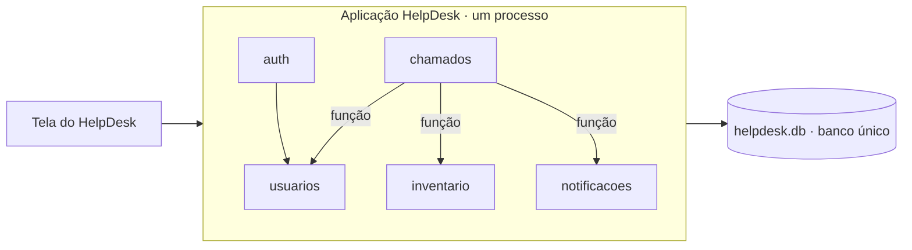
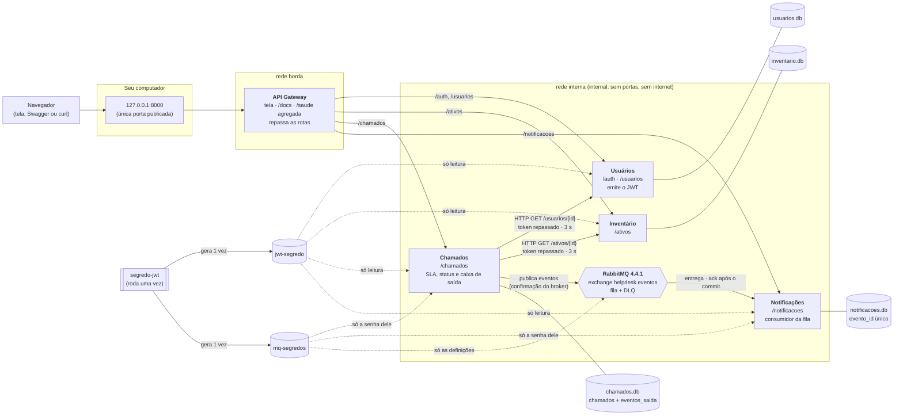
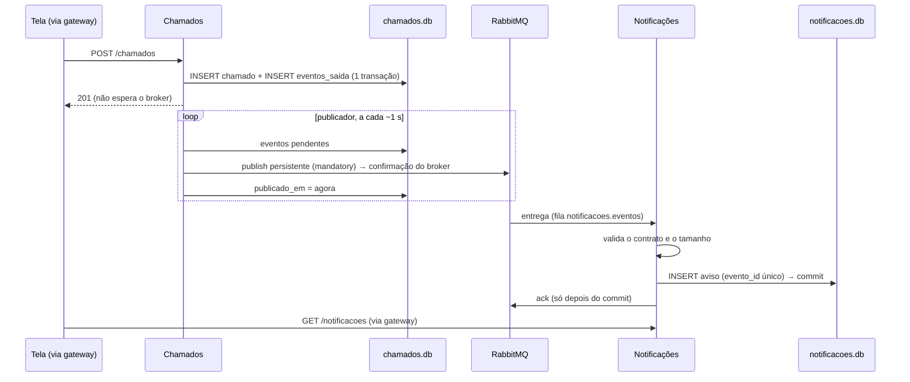

# HelpDesk TI · versão em microsserviços

> 📦 **Repositório:** https://github.com/gmenezes-0/helpdesk-microsservicos-gabriel-menezes
>
> 🎬 **Vídeo de demonstração:** _link a incluir após a gravação_

Sistema de chamados de TI (no estilo de um GLPI simplificado), feito em **Python + FastAPI**.
Ele começou como um **monólito** e, nesta atividade de **Arquitetura de Software**, foi dividido em
**quatro microsserviços, um API Gateway e um broker de mensagens (RabbitMQ)**, como pede o
[DESAFIO.md](DESAFIO.md), incluindo o bônus de notificações por evento. O monólito original continua
no repositório (pasta `app/`), para comparação.

**Sumário:** [Objetivo](#objetivo) · [Arquitetura](#arquitetura) · [Serviços](#responsabilidades-dos-serviços) ·
[Gateway e rotas](#api-gateway-e-rotas) · [Bancos](#bancos-independentes) · [HTTP](#comunicação-http-entre-serviços) ·
[Eventos](#eventos-e-rabbitmq) · [JWT](#autenticação-jwt) · [Falhas](#falhas-e-tempos-limite) ·
[Segurança e rede](#segurança-e-rede) · [Como rodar](#instalação-e-execução) · [Contas](#contas-de-acesso) ·
[Endpoints](#endpoints) · [Testes](#testes) · [Decisões](#decisões-arquiteturais) · [Limitações](#limitações-conhecidas)

## Objetivo

Separar o HelpDesk em serviços independentes, cada um com o próprio banco e o próprio contêiner,
**sem mudar nada para quem usa**: as mesmas telas, as mesmas rotas, as mesmas regras (SLA, transições
de status, permissões por perfil) e o mesmo endereço, `http://localhost:8000`. As notificações deixam de
ser uma chamada de função e passam a ser **eventos assíncronos**: abrir um chamado nunca depende do
serviço de Notificações estar no ar.

## Telas do sistema


| Login | Painel do técnico | Chamado resolvido |
|---|---|---|
|  |  |  |

As imagens são do monólito. A tela é a mesma; só o subtítulo do cabeçalho mudou para "versão em microsserviços".

## O que o sistema faz

- **Login** com e-mail e senha; cada pessoa vê e faz só o que o seu perfil permite.
- Cadastra **usuários** e **equipamentos** (inventário de TI).
- **Abre chamados** com prioridade e calcula o prazo de atendimento (SLA): crítica 4 h, alta 8 h, média 24 h, baixa 72 h.
- **Atribui** chamados a técnicos, controla o **status** e aceita **comentários**.
- Registra **notificações** quando um chamado é aberto, atribuído ou resolvido.
- Mostra um **painel** com totais por status e chamados atrasados.

### Perfis e permissões

| Ação | Solicitante | Técnico | Administrador |
|---|:-:|:-:|:-:|
| Abrir chamado | ✅ | ✅ | ✅ |
| Ver chamados | só os seus | todos | todos |
| Comentar | nos seus | todos | todos |
| Atribuir e resolver | ❌ | ✅ | ✅ |
| Fechar ou reabrir um chamado resolvido | os seus | ✅ | ✅ |
| Cadastrar equipamentos | ❌ | ✅ | ✅ |
| Cadastrar usuários | ❌ | ❌ | ✅ |
| Ver notificações | as suas | as suas | as suas |

## Arquitetura

### Antes: monólito

Uma aplicação, um banco e uma implantação. Os módulos conversavam por **chamadas de função**.



### Agora: microsserviços com eventos

Cada serviço é um processo, um contêiner e um banco. Todos ficam atrás do gateway, que é a única porta
de entrada. Chamados conversa com Usuários e Inventário por **HTTP** (precisa da resposta na hora) e
avisa Notificações por **eventos** no RabbitMQ (não precisa esperar).



Na prática:

1. O navegador só fala com o **gateway**, pela porta 8000.
2. O gateway olha o começo do caminho e repassa a requisição, com o token, ao serviço certo.
3. Cada serviço **confere o token sozinho**, com o segredo compartilhado, e responde com os dados do próprio banco.
4. Para abrir um chamado com equipamento ou atribuir um técnico, o Chamados **pergunta por HTTP**
   ao Inventário ou ao Usuários, repassando o token de quem fez o pedido.
5. Quando um chamado é aberto, atribuído ou resolvido, o Chamados grava um **evento** junto com o chamado
   e responde na hora. O evento é publicado no RabbitMQ em seguida, e o serviço de Notificações grava o aviso.

## Responsabilidades dos serviços

| Serviço | Pasta | Faz | Banco | Depende de |
|---|---|---|---|---|
| **Usuários** | [servicos/usuarios](servicos/usuarios) | Login (senha scrypt, limite de tentativas), emissão do JWT, `/auth/eu`, cadastro e consulta de usuários | `usuarios.db` | ninguém |
| **Inventário** | [servicos/inventario](servicos/inventario) | Cadastro e consulta de equipamentos | `inventario.db` | ninguém |
| **Chamados** | [servicos/chamados](servicos/chamados) | Chamados, SLA, transições de status, comentários e painel. Publica os eventos | `chamados.db` | Usuários e Inventário (HTTP), RabbitMQ (eventos, sem esperar) |
| **Notificações** | [servicos/notificacoes](servicos/notificacoes) | Consome os eventos e grava os avisos; `GET /notificacoes` | `notificacoes.db` | RabbitMQ (eventos) |
| **Gateway** | [gateway](gateway) | Ponto único de entrada: tela, documentação unificada, saúde agregada e repasse das rotas | nenhum | os quatro serviços |
| **RabbitMQ** | [infra/rabbitmq](infra/rabbitmq) | Broker de mensagens (4.4.1-alpine, fixado por digest) | volume próprio | — |
| **segredo-jwt** | [infra/segredo-jwt](infra/segredo-jwt) | Gera o segredo JWT e as credenciais do RabbitMQ na primeira subida e termina | — | — |

Cada serviço tem o seu próprio código, Dockerfile, `requirements.txt` e testes. Ele pode ser construído,
testado e publicado sem os outros.

## API Gateway e rotas

O gateway ([gateway/app/proxy.py](gateway/app/proxy.py)) escolhe o serviço pelo prefixo do caminho:

| Prefixo | Serviço |
|---|---|
| `/auth`, `/usuarios` | Usuários |
| `/ativos` | Inventário |
| `/chamados` | Chamados |
| `/notificacoes` | Notificações |
| `/`, `/app.js`, `/estilo.css` | o próprio gateway (tela) |
| `/docs`, `/openapi.json`, `/saude` | o próprio gateway |
| qualquer outro | 404, sem chamar nenhum serviço |

- O método, o caminho, a query string, o corpo e o `Authorization` vão **como vieram**.
  A resposta volta com o mesmo código e os mesmos cabeçalhos.
- O gateway **não confere o token** nem guarda o segredo: quem decide é cada serviço.
  Assim, nenhuma regra de permissão fica duplicada no gateway.
- O `/openapi.json` junta a documentação dos quatro serviços. Em `/docs`, o Swagger mostra todas as rotas
  num lugar só (clique em **Authorize** e cole o token do login).
- O `/saude` consulta os quatro serviços e responde `"ok"` ou `"degradado"`, dizendo quem está fora do ar.

## Bancos independentes

- Cada serviço tem o seu **SQLite** num **volume Docker só dele**.
  - `usuarios.db` tem a tabela `usuarios`.
  - `inventario.db` tem a tabela `ativos`.
  - `chamados.db` tem as tabelas `chamados`, `comentarios` e `eventos_saida`.
  - `notificacoes.db` tem a tabela `notificacoes`.
- Nenhum serviço monta o volume de outro, e nenhum lê o banco de outro. Se precisa de um dado de fora,
  pergunta pela API ou recebe um evento.
- Em `chamados.db`, `solicitante_id`, `tecnico_id` e `ativo_id` são números simples, **sem chave estrangeira**,
  porque essas tabelas estão em outros bancos. A existência é conferida por HTTP no momento da gravação.

## Comunicação HTTP entre serviços

| Quando | Chamados chama | Para conferir |
|---|---|---|
| Abrir chamado com `ativo_id` | Inventário `GET /ativos/{id}` | que o equipamento existe |
| Atribuir chamado | Usuários `GET /usuarios/{id}` | que a pessoa existe e é técnica |

As regras ficam em [servicos/chamados/app/clientes.py](servicos/chamados/app/clientes.py):

- **Token:** o `Authorization` de quem fez o pedido é repassado exatamente como veio. O Chamados não cria
  token próprio nem "credencial de serviço", então o outro serviço aplica as permissões da própria pessoa.
- **Tempo limite:** 3 s por chamada (`HTTP_TIMEOUT_SEGUNDOS`). Os endereços vêm do ambiente: `USUARIOS_URL` e `INVENTARIO_URL`.
- **Respostas:**
  - `404` vira "Ativo N não encontrado." ou "Usuário N não encontrado.", a mesma mensagem do monólito.
  - Pessoa que não é técnica dá `422`, a mesma regra de negócio de antes.
  - Sem resposta, tempo esgotado, `5xx`, `401` ou `403` vindos de lá, ou resposta fora do formato viram
    **`503`** com mensagem genérica. Os detalhes vão só para o log, e uma falha de rede nunca é tratada
    como erro de regra de negócio.
- Redirecionamentos não são seguidos, e proxies do ambiente são ignorados (`trust_env=False`).

## Eventos e RabbitMQ

### Os três eventos

São os mesmos três fatos que já geravam aviso no monólito. Comentar, fechar e reabrir não avisam ninguém,
como antes.

| Evento | Quando | Quem é avisado | Routing key | Aviso gravado |
|---|---|---|---|---|
| `ChamadoAberto` | Um chamado é aberto | o solicitante | `chamado.aberto` | "Seu chamado #7 foi aberto. Prazo: 25/11 22:03." |
| `ChamadoAtribuido` | Um técnico é atribuído | o técnico | `chamado.atribuido` | "O chamado #7 foi atribuído a você." |
| `ChamadoResolvido` | O status vira `resolvido` | o solicitante | `chamado.resolvido` | "Seu chamado #7 foi resolvido. Confirme se está tudo certo." |

O evento leva **fatos, não textos**: só ids e datas, nunca token, e-mail ou o texto do chamado. Quem redige
o aviso é o serviço de Notificações. Contrato (versão 1):

```json
{
  "id": "6f1c2a0e-…(uuid4)",
  "tipo": "ChamadoAberto",
  "versao": 1,
  "ocorrido_em": "2026-11-25T14:03:00",
  "dados": { "chamado_id": 7, "destinatario_id": 2, "prazo_sla": "2026-11-25T22:03:00" }
}
```

### Fluxo de um evento



### Caixa de saída transacional (outbox)

- O Chamados **não publica dentro da requisição**. Ele grava o evento na tabela `eventos_saida`, **na mesma
  transação** do chamado: ou os dois são gravados, ou nenhum. Assim nunca há chamado sem aviso, nem aviso
  de um chamado que não existe.
- Um **publicador** numa thread própria ([servicos/chamados/app/eventos/publicador.py](servicos/chamados/app/eventos/publicador.py))
  lê os pendentes e publica cada um com **publisher confirms** e `mandatory`. Só depois da confirmação ele marca
  `publicado_em`.
- Com o RabbitMQ fora, os eventos **esperam no banco**, e o publicador tenta de novo com espera crescente
  (1 s → 30 s). Quando o broker volta, tudo o que estava pendente é publicado.

### Consumo, deduplicação e mensagens mortas

O consumidor fica em [servicos/notificacoes/app/eventos/](servicos/notificacoes/app/eventos/) e usa Pika 1.5.0 com `BlockingConnection`.

| Situação | O que o consumidor faz |
|---|---|
| Evento válido | Grava o aviso e dá **ack só depois do commit** |
| Evento repetido (mesmo `id`) | A coluna `evento_id` é `UNIQUE`: não grava de novo e dá ack. Cada evento gera **um aviso só** |
| Fora do contrato (JSON inválido, campo a mais ou faltando, tipo desconhecido, versão errada, mais de 8 KB) | `basic_reject(requeue=False)` → vai para a **DLQ** `notificacoes.eventos.dlq`. O log mostra só o motivo e o tamanho, nunca o conteúdo |
| Falha temporária (banco travado, disco) | `basic_reject(requeue=True)`: volta para a fila. A fila quorum tem `delivery-limit` 5; depois disso, a mensagem vai para a DLQ |
| Queda do consumidor ou da conexão | Mensagens sem ack são reentregues; a deduplicação evita aviso repetido. O consumidor reconecta sozinho |

O consumidor usa `basic_reject`, e não `basic_nack`: no RabbitMQ 4.4.1, o `nack` com requeue **não conta**
para o `delivery-limit`, o que deixaria uma mensagem problemática em laço infinito (verificado na prática).

### Topologia no RabbitMQ

| Recurso | Configuração |
|---|---|
| Vhost | `helpdesk` |
| Exchange `helpdesk.eventos` | `topic`, durável |
| Fila `notificacoes.eventos` | quorum, durável, ligada a `chamado.*`, `delivery-limit` 5, mensagens mortas para `helpdesk.eventos.dlx` |
| Exchange `helpdesk.eventos.dlx` → fila `notificacoes.eventos.dlq` | `fanout` → quorum, durável |
| Usuário `chamados` | só **publica** em `helpdesk.eventos` |
| Usuário `notificacoes` | só **lê** `notificacoes.eventos` |

Não há `guest` nem administrador. A topologia e os usuários vêm de um arquivo de definições gerado na
primeira subida (veja [SECURITY.md](SECURITY.md)).

## Autenticação JWT

1. **Emissão:** só o Usuários faz login e emite o token: HS256, emissor `helpdesk-ti`, validade de
   `TOKEN_MINUTOS`, com os campos `sub` (id) e `perfil`.
2. **Conferência em todo serviço:** cada serviço valida o token localmente, sem perguntar a ninguém.
   - Confere assinatura, algoritmo fixo, emissor e validade.
   - Exige todos os campos e só aceita perfis conhecidos.
   - O Usuários, que tem o banco de usuários, também confere se a conta existe e está ativa.
3. **Segredo compartilhado:**
   - o contêiner `segredo-jwt` gera 48 bytes aleatórios (`secrets`) na primeira subida e os grava no volume
     `jwt-segredo` (arquivo 0400, pasta 0500);
   - os quatro serviços leem esse arquivo (`JWT_SEGREDO_ARQUIVO`), montado só para leitura;
   - o segredo **não está no código, no `.env`, nas variáveis de ambiente nem nos logs**;
   - se o arquivo estiver faltando ou curto, o serviço **não sobe**, para nunca assinar com um segredo diferente dos outros.
4. **Permissões:** o perfil e o id usados nas regras são sempre os do token assinado, nunca um campo enviado
   pelo cliente. Em `/notificacoes`, cada pessoa só vê os avisos em que ela é a destinatária.

## Falhas e tempos limite

| Situação | O que acontece |
|---|---|
| Inventário fora do ar | `/ativos` e abrir chamado **com** equipamento: **503** "O serviço de inventário está indisponível…". Usuários, chamados, painel e tela continuam funcionando |
| Usuários fora do ar | Login, `/usuarios` e atribuir: **503**. Quem já tem token continua vendo chamados e equipamentos |
| Chamados fora do ar | `/chamados`: **503**. O resto funciona |
| **Notificações fora do ar** | `/notificacoes`: **503**. Os chamados continuam sendo abertos; os eventos esperam na fila e os avisos aparecem quando o serviço volta |
| **RabbitMQ fora do ar** | Tudo continua funcionando. Os eventos esperam na caixa de saída do Chamados e são publicados quando o broker volta |
| Serviço lento | Chamados desiste em **3 s**; o gateway desiste em **10 s**, que fica acima dos 3 s para o 503 do Chamados chegar à tela |
| `GET /saude` | `"degradado"` e o nome do serviço `"fora do ar"`. O gateway continua respondendo 200. O `/saude` interno de Notificações também informa se o consumidor está `conectado` |
| Serviço volta | O Docker reinicia contêineres que caem sozinhos (`restart: unless-stopped`); o próximo pedido já funciona |

## Segurança e rede

O resumo está aqui; os detalhes ficam em [SECURITY.md](SECURITY.md).

- **Só o gateway publica porta**, e só em `127.0.0.1:8000`, ou seja, apenas para o próprio computador.
  Os serviços e o RabbitMQ não publicam portas.
- **Redes:**
  - `borda` tem só o gateway.
  - `interna` (`internal: true`) tem o gateway, os serviços e o RabbitMQ: não tem saída para a internet e não
    pode ser alcançada de fora.
- **Contêineres** (todos, inclusive o RabbitMQ e o gerador):
  - sistema de arquivos somente leitura;
  - `cap_drop: ALL` e `no-new-privileges`;
  - usuário sem privilégios (uid 10001);
  - `/tmp` em memória, limitado, só onde é preciso.
- **RabbitMQ:** sem `guest`, sem plugins (sem painel e sem porta de métricas), um usuário por serviço com
  permissão mínima, e o Erlang (clustering e EPMD) escutando só no localhost.
- **Endereço do cliente:**
  - o gateway descarta `X-Forwarded-For`, `X-Real-IP` e `Forwarded` enviados pelo cliente e escreve o seu;
  - os serviços só aceitam esse cabeçalho vindo do IP fixo do gateway (`FORWARDED_ALLOW_IPS`);
  - assim, o bloqueio de tentativas de login não é contornado forjando o cabeçalho.
- **Gateway:** os mesmos cabeçalhos de segurança do monólito (CSP, `X-Frame-Options`…), limite de 64 KB por
  requisição, e nada de tokens nos logs.

## Instalação e execução

**Pré-requisito:** Docker com Docker Compose v2 (por exemplo, Docker Desktop). Não é preciso ter Python
instalado nem criar `.env`.

```bash
git clone https://github.com/gmenezes-0/helpdesk-microsservicos-gabriel-menezes.git
cd helpdesk-microsservicos-gabriel-menezes
docker compose up --build
```

Na primeira vez, a construção leva alguns minutos. O sistema está pronto quando `docker compose ps` mostrar os
seis contêineres de longa duração `healthy` (gateway, usuarios, inventario, chamados, notificacoes, rabbitmq)
e o `segredo-jwt` como `Exited (0)`. A ordem de subida é automática:
`segredo-jwt` → `rabbitmq`, `usuarios`, `inventario` e `notificacoes` → `chamados` → `gateway`.
O Chamados e o Notificações **não esperam** o RabbitMQ: eles se conectam a ele assim que ele responde.

Depois abra:

- Tela do HelpDesk: http://localhost:8000
- Documentação da API (Swagger): http://localhost:8000/docs
- Saúde dos serviços: http://localhost:8000/saude

| Comando | Para quê |
|---|---|
| `docker compose ps` | Ver o estado de cada contêiner e as portas |
| `docker compose logs -f chamados` | Acompanhar os logs de um serviço |
| `docker compose stop inventario` / `docker compose start inventario` | Simular a queda de um serviço e a volta |
| `docker compose stop notificacoes` / `docker compose stop rabbitmq` | Mostrar que os chamados continuam sendo abertos e os avisos chegam depois |
| `docker compose exec rabbitmq rabbitmqctl list_queues -p helpdesk name messages` | Ver as filas (inclusive a DLQ) |
| `docker volume ls --filter name=helpdesk` | Ver os volumes: um por banco, mais os de segredo e o do RabbitMQ |
| `docker compose exec usuarios ls /dados` | Ver o banco de um serviço (troque o nome do serviço) |
| `docker compose down` | Parar tudo; dados e segredos ficam guardados |
| `docker compose down -v` | Parar e **apagar** dados e segredos, voltando ao início |

No Git Bash (Windows), rode antes `export MSYS_NO_PATHCONV=1`, senão caminhos como `/dados` viram caminhos do Windows.

### Configuração

Tudo é opcional. Para mudar algo, copie [.env.example](.env.example) para `.env` (que nunca vai para o Git):

| Variável | Padrão | Para quê |
|---|---|---|
| `TOKEN_MINUTOS` | `60` | Validade do login |
| `DADOS_EXEMPLO` | `1` | Cria contas, equipamentos e chamados de exemplo no banco vazio |
| `SENHA_EXEMPLO` | `Helpdesk2026` | Senha das contas de exemplo |
| `DOCS` | `1` | `0` desliga `/docs` e `/openapi.json` |
| `REDE_INTERNA_SUBREDE` / `GATEWAY_IP_INTERNO` | `172.30.80.0/24` / `172.30.80.10` | Mude só se essa faixa já for usada na sua máquina |

Nenhuma senha do RabbitMQ nem o segredo JWT ficam no `.env`: são gerados sozinhos. Para **trocar o segredo JWT**
(derruba todos os logins): `docker compose down && docker volume rm helpdesk_jwt-segredo && docker compose up`.
Para **trocar as senhas do RabbitMQ** (apaga também as mensagens que estiverem na fila): `docker compose down && docker volume rm helpdesk_mq-segredos helpdesk_rabbitmq-dados && docker compose up`.

### Versão monolítica (para comparar)

```bash
docker compose -f docker-compose.monolito.yml up --build     # pare a versão em microsserviços antes: mesma porta
```

Ou, sem Docker (Python 3.11 ou mais novo): `pip install -r requirements-dev.txt` e `uvicorn app.main:app --reload`.

## Contas de acesso

O sistema já começa com estes usuários, todos com a senha **`Helpdesk2026`**:

| E-mail | Perfil | O que pode fazer |
|---|---|---|
| `admin@empresa.com` | Administrador | Tudo, inclusive cadastrar usuários |
| `carla@empresa.com` | Técnica | Ver todos os chamados, atribuir, resolver e cadastrar equipamentos |
| `diego@empresa.com` | Técnico | O mesmo que a Carla |
| `ana@empresa.com` | Solicitante | Abrir chamados e ver só os próprios |
| `bruno@empresa.com` | Solicitante | O mesmo que a Ana |

- Para o fluxo completo (abrir, atribuir, resolver e fechar), entre como **Carla**. Para as permissões,
  entre como **Ana**: ela não vê os chamados do Bruno.
- Também há 3 equipamentos (`PAT-0001` a `PAT-0003`), 3 chamados de exemplo e os avisos deles, que chegam
  a Notificações pelos mesmos eventos de qualquer chamado.
- Os dados só são criados com `DADOS_EXEMPLO=1` (o padrão) e com o banco vazio.

> Estas contas têm senha conhecida e servem só para aula. Em produção, use `DADOS_EXEMPLO=0`.

## Endpoints

Todos passam pelo gateway em `http://localhost:8000` e exigem login, exceto `/auth/login`, `/saude`, a tela e `/docs`.

| Método | Rota | Serviço | O que faz | Quem pode |
|---|---|---|---|---|
| POST | `/auth/login` | Usuários | Entra e recebe o token | Todos |
| GET | `/auth/eu` | Usuários | Dados de quem está logado | Logado |
| POST | `/usuarios` | Usuários | Cria usuário | Admin |
| GET | `/usuarios` | Usuários | Lista usuários, sem e-mail (filtro `?perfil=`) | Logado |
| GET | `/usuarios/{id}` | Usuários | Um usuário, sem e-mail | Logado |
| POST | `/ativos` | Inventário | Cadastra equipamento | Técnico e admin |
| GET | `/ativos` | Inventário | Lista equipamentos (filtro `?setor=`) | Logado |
| GET | `/ativos/{id}` | Inventário | Um equipamento | Logado |
| POST | `/chamados` | Chamados | Abre chamado em nome de quem está logado | Logado |
| GET | `/chamados` | Chamados | Lista chamados (filtros `?status=` e `?tecnico_id=`) | Logado (solicitante vê só os seus) |
| GET | `/chamados/painel` | Chamados | Totais por status e atrasados | Logado |
| GET | `/chamados/{id}` | Chamados | Um chamado, com comentários | Dono e equipe |
| PATCH | `/chamados/{id}/atribuir` | Chamados | Atribui a um técnico | Técnico e admin |
| PATCH | `/chamados/{id}/status` | Chamados | Muda o status | Técnico e admin (solicitante: fechar ou reabrir) |
| POST | `/chamados/{id}/comentarios` | Chamados | Comenta no chamado (não fechado) | Dono e equipe |
| GET | `/notificacoes` | Notificações | Minhas notificações | Logado (cada um vê só as suas) |
| GET | `/saude` | Gateway | Saúde de todos os serviços | Todos |
| GET | `/docs`, `/openapi.json` | Gateway | Documentação unificada | Todos (desligável com `DOCS=0`) |

Dentro da rede interna, cada serviço também tem o seu `GET /saude`, que testa o próprio banco. É ele que
o Docker usa no healthcheck. Não existe rota para criar avisos: eles só nascem de eventos.

## Testes

Cada projeto tem os seus testes e roda sozinho. Os testes de segurança foram adaptados a cada serviço:
token falso, vencido, sem campos ou com perfil inventado; permissões; campos extras; limites; cabeçalhos.

| Projeto | Testes | O que cobrem |
|---|---:|---|
| Monólito (`tests/`) | 36 | Referência original, sem alterações |
| Usuários | 39 | Login, bloqueio de tentativas, emissão do token, usuários, segredo |
| Inventário | 39 | Equipamentos, validação local do token, permissões |
| Chamados | 98 | Regras, SLA e status; HTTP com falhas simuladas; caixa de saída (um evento por fato, rollback conjunto, nada de token no evento); publicador (confirmação, mandatory, broker fora, republicação com o mesmo id) |
| Notificações | 81 | Token; cada um vê só os seus avisos; textos iguais aos do monólito; deduplicação; 23 casos de mensagem fora do contrato; ack só depois do commit; `reject` com e sem requeue (nunca `nack`); reconexão |
| Gateway | 87 | Roteamento das 16 rotas, cabeçalhos, X-Forwarded-For, 413, 503 (inclusive de Notificações), saúde, tela e documentação |
| Gerador de segredos | 23 | Segredo JWT e credenciais do RabbitMQ: força, permissões, hashes, não sobrescrever, estados inválidos (só em Linux) |
| **Total** | **403** | |

Para rodar um projeto (Python 3.12):

```bash
cd servicos/notificacoes      # ou servicos/usuarios, servicos/inventario, servicos/chamados, gateway, infra/segredo-jwt, ou a raiz (monólito)
pip install -r requirements-dev.txt
pytest -q
pip-audit -r requirements.txt
```

No **GitHub Actions** ([.github/workflows/testes.yml](.github/workflows/testes.yml)), a cada envio:

1. uma matriz testa os 7 projetos separadamente, com `pytest` e `pip-audit` nas dependências de cada um;
2. depois, o sistema inteiro sobe com `docker compose up --build`, e o CI confere:
   - saúde dos quatro serviços, 401 sem token, login e se só o gateway tem porta publicada;
   - a **entrega real de um aviso**: abre um chamado e espera o aviso chegar em `/notificacoes`;
   - o RabbitMQ endurecido: só os dois usuários, nenhum plugin, Erlang só no localhost e a DLQ vazia;
   - se a imagem do RabbitMQ está fixada por versão e digest.

O Dependabot acompanha as dependências Python e as imagens base de cada pasta, inclusive a do RabbitMQ.

## Estrutura

```
├── docker-compose.yml           # versão em microsserviços (a entrega)
├── docker-compose.monolito.yml  # versão monolítica original
├── gateway/                     # API Gateway: proxy.py, documentacao.py, web/ (tela)
├── servicos/
│   ├── usuarios/                # app/auth, app/usuarios, tests/, Dockerfile
│   ├── inventario/              # app/inventario, app/auth (só valida token), tests/, Dockerfile
│   ├── chamados/                # app/chamados, app/clientes.py (HTTP), app/eventos (caixa de saída e publicador)
│   └── notificacoes/            # app/notificacoes, app/eventos (contrato, processador e consumidor)
├── infra/
│   ├── segredo-jwt/             # gerador do segredo JWT e das credenciais do RabbitMQ (execução única)
│   └── rabbitmq/                # imagem do broker: digest fixo, configuração, nenhum plugin
├── app/ e tests/                # monólito original, mantido para comparação
└── .github/                     # CI (matriz por projeto + Compose) e Dependabot
```

## Decisões arquiteturais

1. **Quatro serviços pelos limites que o monólito já tinha.** Cada módulo com porta pública (`servico.py`) virou
   um serviço, inclusive as notificações, que viraram o serviço de Notificações alimentado por eventos.
2. **Um SQLite por serviço, cada um no seu volume.** É o mais simples de subir sem ajustes manuais, e já
   garante o isolamento. Um PostgreSQL por serviço seria o passo seguinte em produção.
3. **HTTP quando a resposta é necessária, evento quando não é.** Validar técnico e equipamento precisa da
   resposta antes de gravar (HTTP com timeout). Avisar alguém não precisa: virou evento, e a queda de
   Notificações ou do broker não impede abrir chamados.
4. **RabbitMQ com caixa de saída transacional.** Gravar o evento na mesma transação do chamado evita perder
   eventos (broker fora) e evita eventos de chamados que não existem (rollback). O custo é a entrega
   **pelo menos uma vez**, resolvida com deduplicação por `evento_id` no consumidor.
5. **Eventos com fatos, não com textos.** O evento leva ids e datas; o texto do aviso é responsabilidade
   de Notificações. Isso mantém os textos idênticos aos do monólito e nada sensível passa pela fila.
6. **Pika 1.5.0 com `BlockingConnection`**, numa thread por serviço. Os serviços são síncronos, e a
   confirmação do broker síncrona é o que a caixa de saída precisa. A API está marcada como obsoleta para a
   2.0; o uso fica isolado num módulo por serviço, e o Dependabot avisa quando a 2.0 sair.
7. **Validação local do JWT em cada serviço.** Não há chamada ao Usuários a cada pedido: os serviços
   continuam funcionando se o Usuários cair. O custo está nas [limitações](#limitações-conhecidas).
8. **Segredos gerados automaticamente em volumes protegidos**, em vez de `JWT_SEGREDO` no `.env`.
   - O DESAFIO sugere o `.env`. Aqui os segredos continuam fora do código, mas `docker compose up --build`
     funciona sem nenhum passo manual, e não existe o risco de esquecer o segredo ou deixar um fraco.
   - Nada vira variável de ambiente, que aparece em `docker inspect`. Cada serviço monta só a sua senha do broker.
9. **Código de autenticação copiado, não compartilhado.** Cada serviço tem o seu `auth/`, sem biblioteca comum.
   Isso mantém os serviços independentes; a desvantagem é repetir uma mudança no formato do token em cada um.
10. **Token do usuário repassado entre serviços**, em vez de credencial de serviço: Inventário e Usuários
    aplicam as permissões de quem realmente fez o pedido.
11. **Gateway próprio em FastAPI + httpx**, que serve a tela sem mudanças, junta a documentação e agrega a saúde.
12. **503 para falha de infraestrutura, nunca erro de negócio**: um serviço fora do ar não pode virar
    "ativo não encontrado".
13. **Python 3.12 e RabbitMQ 4.4.1 fixados** (este por versão e digest), testados também no Python 3.14.
14. **Monólito preservado** em `app/` e em `docker-compose.monolito.yml`, para comparação.

## Limitações conhecidas

- **Avisos antigos não foram migrados.** Quem tinha um `chamados.db` de uma versão anterior (com a tabela
  antiga de notificações) não vê esses avisos no novo serviço. Os avisos novos e os dos dados de exemplo
  funcionam normalmente; para começar limpo, use `docker compose down -v`.
- **Entrega pelo menos uma vez e ordem não garantida.** Um evento pode ser publicado mais de uma vez (o
  consumidor descarta a duplicata) e chegar fora de ordem; a lista de avisos é ordenada pela data do fato.
- **Atraso dos avisos depois de uma queda longa do broker.** O publicador e o consumidor reconectam com
  espera crescente de até 30 s, então o aviso pode levar até ~30 s depois de o RabbitMQ voltar.
- **DLQ sem reprocessamento automático.** Mensagens na fila de mensagens mortas ficam lá para análise
  (`rabbitmqctl list_queues`); não há ferramenta para devolvê-las à fila.
- **IP de origem no Docker Desktop.** No Windows e no macOS, todo acesso vindo do próprio computador chega com
  o mesmo IP da ponte (ex.: `172.18.0.1`). O bloqueio por "e-mail + endereço" acaba tratando todos os
  acessos locais como um só endereço; o bloqueio por e-mail funciona normalmente.
- **Validade dos tokens depois de desativar um usuário.** Inventário, Chamados e Notificações validam o
  token sozinhos. Um usuário desativado, ou com o perfil trocado, continua sendo aceito neles até o token vencer
  (`TOKEN_MINUTOS`, 60 min). O Usuários recusa na hora. Para revogar todos os tokens, troque o segredo.
- **IDs fixos nos dados de exemplo.** Os chamados de exemplo apontam para os usuários e equipamentos de exemplo
  pelos ids (Ana = 2, Carla = 4, PAT-0001 = 1…). Isso só vale quando os bancos são criados juntos e vazios.
- **URL interna errada é lida como "não encontrado".** Se `USUARIOS_URL` ou `INVENTARIO_URL` apontar para um
  servidor errado que responda 404, o Chamados mostra "Usuário/Ativo N não encontrado." em vez de 503.
- **Horários em UTC dentro dos contêineres.** O prazo mostrado nos avisos e na tela segue o relógio do
  contêiner (UTC), e não o horário de Brasília.
- **Limite de tentativas de login em memória.** Funciona com uma instância do Usuários.
- **Memória.** O RabbitMQ acrescenta cerca de 90 a 160 MiB ao sistema.
- **Sem HTTPS e sem TLS entre serviços.** A porta só aceita conexões do próprio computador; para publicar
  de verdade, veja [SECURITY.md](SECURITY.md).

## Segurança

O que está protegido e o que fazer antes de usar em produção está em [SECURITY.md](SECURITY.md).
